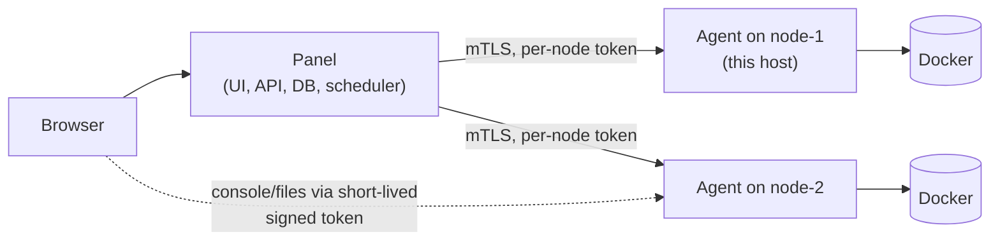

# Roadmap

Where the panel is headed: from a single-host Minecraft panel to **Latticore** — a modern, self-hosted game server panel for homelabs and communities, with **deeply integrated games, any number of machines, and plugins and themes for the panel itself** — without losing what it does well today (one `docker compose up -d`, a fast and polished UI, real security defaults).

Phases are ordered by dependency; each one ships on its own.

## Decisions so far

| Topic | Decision |
|---|---|
| Name & brand | **Latticore** — the node-cube mark and pink palette (design board: *Panel Rebrand – Name & Logo*); name checked free on GitHub and npm |
| Audience | **Homelab & communities first.** One admin or a small team on their own hardware; hosting-provider features (quotas, billing, hard multi-tenancy) are not a goal for now |
| Games | **Built-in, first-class game integrations** — not a generic template/egg system like Pterodactyl. Every game is picked from a curated list and gets its own features (Minecraft: player manager, Modrinth, server.properties editor, …) |
| Multiple machines | **Own lightweight agent** per machine; the panel's host is automatically node 1 |
| First games after Minecraft Java | **Steam games** (via SteamCMD) and **Minecraft Bedrock + proxies** (Velocity/BungeeCord, Geyser) |
| "Plugins" | Plugins **for the panel itself** (new pages, tabs, integrations) — not game-server plugins, which the Modrinth integration already covers |

## Principles

- **One command to start, still.** A single-host install stays exactly as simple as today. More machines are something you *add*, not a new install mode.
- **Depth over breadth.** A game is only listed when it's genuinely integrated — installing, updating, configuring, and managing its players/mods from the panel — rather than "it boots in a container".
- **The panel never trusts a node, and a node never trusts a server.** Every boundary (browser → panel, panel → node, node → game container) is authenticated and least-privilege.
- **Plugins can't break the panel.** A broken plugin or theme degrades its own feature, never the dashboard.

## Phase 0 — Foundation (done)

Robust lifecycle (no stuck statuses, boot recovery), Forge/NeoForge, reinstall/version switch, consistent backups with retention and locking, timezone-aware scheduler, security headers, proxy-aware rate limiting, dependency hygiene, ESLint in CI.

## Phase 1 — Rebrand to Latticore, proxy networks (done)

- Name, logo, favicon/PWA icons, splash, manifest and docs are Latticore. Still open: renaming the GitHub repository and the Docker image names — with the old image names kept publishing for a transition period so existing installs keep updating.
- Velocity and BungeeCord as server types, with one-click networks (forwarding, secret, online-mode and port hiding done automatically) and a Networks overview.
- UniversalAdmin recommended on the Modrinth and Plugins pages.

## Phase 2 — Game integrations (multi-game)

Today "Minecraft" is hard-wired through the codebase. Make **game** a first-class concept with one module per game, each a real piece of code living in the repo:

```
apps/api/src/games/
  minecraft-java/   providers (Vanilla/Paper/Fabric/Forge/NeoForge), player manager, Modrinth, server.properties …
  minecraft-bedrock/
  velocity/
  valheim/          SteamCMD install, world/password config, A2S query …
apps/web/src/games/<same ids>/   that game's tabs, wizard steps, overview widgets
```

What a game module provides — the panel core only knows this contract:

| Capability | Minecraft Java (today) | Valheim (example) |
|---|---|---|
| Versions / flavors | Vanilla, Paper, Fabric, Forge, NeoForge × Minecraft version | Steam branch (public / beta) |
| Install & update | panel-owned install pipeline, reinstall/version switch | SteamCMD app `896660`, validate-on-update |
| Runtime | Java 8–25 images | SteamCMD/Debian image |
| Launch, ready, stop | launch script, `Done (…)!` line, `stop` | startup args, "Game server connected", SIGINT |
| Console | attached stdin | stdout only (no console input) |
| Config editors | `server.properties`, Paper configs | world name, password, crossplay, public flag |
| Players | full player manager (whitelist/op/ban/kick, playtime, skins) | online list + kick/ban via A2S/admin list |
| Content | Modrinth plugins/mods | BepInEx mods (later) |
| Ports | game port + allocations | game + query (UDP) |

- The create wizard starts with **picking a game** (icon grid), then that game's own steps.
- Server pages show only the tabs a game provides — no empty "Players" tab for a game without one.
- Shared building blocks (console, files, backups, scheduler, notifications, allocations) stay in the core and work for every game.
- **First wave**: Minecraft Bedrock (+ Geyser on the existing proxies), and Steam games via a shared SteamCMD installer — e.g. Valheim, Palworld, Project Zomboid, CS2, Rust. Exact Steam list driven by demand.

## Phase 3 — Nodes (multiple machines)

Split the Docker-facing half of the API into an **agent** that runs on every machine, and make the panel a control plane:



- The agent owns everything that touches a host: containers, data directories, console attach, file manager, backups, installers. `MinecraftRuntime` is already that seam — it becomes the agent's API.
- **The panel's own host is node 1**, running the same agent embedded, so single-host installs keep working with zero extra setup.
- Adding a node = one command on the new machine (`docker run … agent --join <token>`), shown in the panel.
- Per-node allocations (IP + port pools), capacity (RAM/CPU/disk), and health; the create wizard picks a node (or the emptiest one).
- Heavy streams (console, file up/downloads, backup downloads) go browser ↔ agent directly with short-lived signed tokens — the panel doesn't become a bandwidth bottleneck.
- Later: server **transfer** between nodes, off-node backups (S3/SFTP/restic), optional PostgreSQL alongside SQLite.

## Phase 4 — Panel plugins and themes

**Plugins** extend the panel itself:

- A manifest (`id`, `version`, required permissions, settings schema) plus:
  - **Backend**: routes under `/api/ext/<id>/`, its own scoped storage, and event hooks (server started/stopped, backup created, player joined, …).
  - **Frontend**: UI slots — a new sidebar page, a server tab, a dashboard card, a settings section — rendered in a sandboxed iframe that talks to the panel through a small typed message API, so a buggy plugin can't crash or restyle the rest of the UI.
- Plugins declare the permissions they need; the admin approves them on install, and a plugin can add its own RBAC permissions.
- First-party plugins to prove the API: Discord bridge (status, chat relay, slash commands), web map embed (BlueMap/Dynmap/squaremap), public status page, Modrinth/CurseForge modpack installer.
- Later: a plugin index with signed releases.

**Themes**:

- Every color, radius, and font is already a CSS variable; a theme is a JSON file of those tokens plus optional CSS.
- Built-in light/dark/high-contrast; a theme editor with live preview; import/export; admin default plus per-user choice.
- Branding: panel name, logo, favicon, login background — so a community can make the panel its own.

## Phase 5 — Teams and integrations

- **API keys / personal access tokens**, a documented REST API, outbound **webhooks**.
- **SSO**: OIDC (Authentik, Keycloak, Google), Discord login, passkeys.
- **Sub-users per server** with fine-grained permissions (already half there via per-server access levels).
- **Translations** — German first.

## Still open

- **Fabric/Forge backends in networks** — need a proxy-forwarding mod (FabricProxy-Lite, Proxy-Compatible-Forge) installed and configured; the panel could do that through the Modrinth integration.

- **Legacy (itzg/RCON) runtime** — remove once no servers use it.
- Exact list of Steam games in the first wave.
